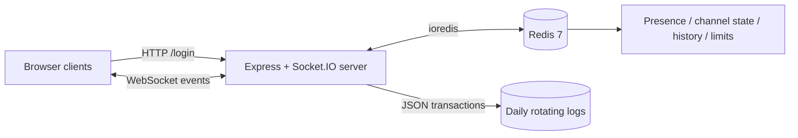

# Realtime Hub: Concurrent WebSocket Communication Service

High-concurrency chat backend with multiple channels, Redis caching of active
users, and persistent timestamped transaction logs.

## Features

- Real-time full-duplex messaging over Socket.IO (WebSocket)
- Multiple channels with live member counts, join/leave, and message history
- Private messages, typing indicators, and online presence
- Redis-backed presence, channel membership, history cache, and rate limiting
- JWT authentication, input validation, and per-user rate limiting
- Daily rotating JSON transaction logs with ISO timestamps
- Graceful shutdown, health endpoint, Docker support, and Jest coverage

## Architecture



Clients authenticate through `POST /login`, then connect with the returned JWT
in the Socket.IO authentication payload. Socket.IO rooms manage channel and
per-user delivery; Redis stores shared state and history.

## Tech stack

Node.js 20, Express 5, Socket.IO 4, Redis 7 (ioredis), Winston, JWT, Jest,
Docker Compose, and a vanilla HTML/CSS/JavaScript client.

## Quick start

### Docker (recommended)

Copy `.env.example` to `.env`, replace the sample `JWT_SECRET`, then start the
application and its persistent Redis instance together:

```bash
docker compose up --build -d
```

Verify that both services are healthy with `docker compose ps`, then open
`http://localhost:3000` or request `http://localhost:3000/health`. Transaction
logs are persisted in `./logs`; Redis data is held in the named `redis-data`
volume and survives `docker compose down`.

Use `docker compose logs -f app` to follow server logs, `docker compose exec
redis redis-cli` to inspect Redis, and `docker compose down` to stop the stack.

## Load-test results

The Socket.IO load harness signs each client in with a JWT, joins clients across
multiple channels, and measures acknowledgement and end-to-end delivery latency.
Run it with `node load-test/load.js --clients=<count> --channels=<count> --duration=<seconds>`.

| Clients | Channels | Connected | Messages/s sent | Deliveries/s | Delivery p95 (ms) | Ack p95 (ms) | Errors |
| ---: | ---: | ---: | ---: | ---: | ---: | ---: | ---: |
| 100 | 5 | 100/100 | 16.7 | 333.2 | 6 | 6.5 | 0 |
| 500 | 10 | 500/500 | 83.3 | 4163.2 | 15 | 17.6 | 0 |
| 1000 | 20 | 1000/1000 | 183.0 | 9148.2 | 99 | 115.5 | 0 |

Measurements were taken with the client and server sharing one machine: an Intel
Core i5-7200U (4 logical CPUs) with 15.9 GiB RAM. The 1,000-client run delivered
549,050 channel messages with no connection failures or message rejections.

Individual reports are saved in `load-test/results-100-clients.json`,
`load-test/results-500-clients.json`, and `load-test/results-1000-clients.json`.

## HTTP API

| Method | Endpoint | Request | Response |
| --- | --- | --- | --- |
| `POST` | `/login` | `{ "username": "alice" }` | JWT and `{ id, username }` user object |
| `GET` | `/health` | — | `{ status: "ok", redis: "up", uptime }`, or `503` when Redis is unavailable |

Usernames must contain 3–20 letters, numbers, or underscores.

## Socket event reference

Every client event accepts an acknowledgement callback. Successful callbacks are `{ ok: true, ... }`; validation and authorization failures are `{ ok: false, error }`.

| Client event | Payload | Acknowledgement | Server push |
| --- | --- | --- | --- |
| `channel:join` | `{ channel }` | normalized channel, chronological `history`, `members` | `channel:user_joined`, `channels:updated` |
| `channel:leave` | `{ channel }` | channel name | `channel:user_left`, `channels:updated` |
| `channel:list` | `{}` | `{ channels: [{ name, members }] }` | — |
| `message:send` | `{ channel, text }` | saved `message` | `message:new` to the channel |
| `message:private` | `{ to, text }` | private `message` | `message:private` to sender and recipient |
| `typing:start` | `{ channel }` | empty success payload | `typing` to other members |
| `typing:stop` | `{ channel }` | empty success payload | `typing` to other members |
| `presence:list` | `{}` | `{ users: [{ id, username }] }` | — |

The server also emits `presence:update` when a user becomes online or offline and `server:shutdown` before graceful shutdown begins. Channel names normalize to lowercase and must be 2–30 characters of `a-z`, `0-9`, `_`, or `-`. Messages are trimmed and limited to the configured maximum length (1,000 by default).

## Redis key schema

| Key pattern | Redis type | Purpose |
| --- | --- | --- |
| `online_users` | sorted set | User IDs scored by heartbeat timestamp for stale-presence cleanup |
| `user:<id>` | hash | Username, connection time, and latest heartbeat |
| `user:<id>:sockets` | set | Socket IDs for a multi-tab user |
| `channels` | set | Known channel names, including defaults |
| `channel:<name>:counts` | hash | Per-user socket counts within a channel |
| `channel:<name>:names` | hash | Channel member IDs mapped to usernames |
| `channel:<name>:history` | list | Most recent serialized channel messages |
| `ratelimit:<id>` | string with expiry | Per-user fixed-window message count |
